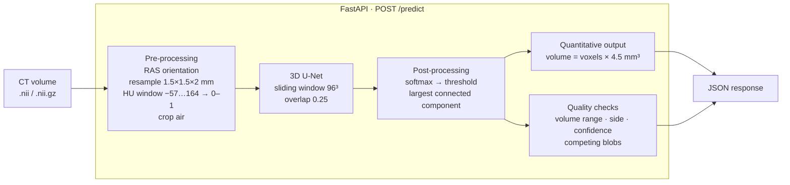

# Spleen CT Segmentation and Volumetry

3D U-Net that segments the spleen in abdominal CT and reports its volume in mL, served through a FastAPI endpoint.
Built as a take-home engineering assessment for mPragati (IIT Delhi). **Not a clinical device; results below are research numbers on public data.**

| | |
|---|---|
| Task | Binary segmentation of the spleen in 3D CT, plus spleen volume (mL) |
| Data | Medical Segmentation Decathlon Task09 Spleen (41 labelled CTs, single centre) |
| Model | MONAI 3D U-Net, residual units, 4.8 M parameters, trained from scratch, then multi-centre fine-tuned |

| Model | MSD held-out test (n=6) | TotalSegmentator external test (n=25) |
|---|---|---|
| Baseline, MSD only (`best_model_ft.pth`) | Dice 0.908 ± 0.053 | Dice 0.548 ± 0.431, 10/25 failures |
| **Multi-centre, default** (`best_model_multicenter.pth`) | **Dice 0.924 ± 0.043**, median vol. error 2.3 % | **Dice 0.895 ± 0.106** (median 0.931), 1/25 failures, median vol. error 4.6 % |

## Architecture



## Repository layout

```
├── src/
│   ├── config.py                  every constant shared by training and inference
│   ├── data/transforms.py         MONAI pre-processing / augmentation pipelines
│   ├── models/unet.py             network definition, .pth / .onnx loader
│   ├── models/export_onnx.py      ONNX export + parity check
│   ├── models/quantize_onnx.py    dynamic int8 + benchmark
│   ├── models/qnn_prepare.py      graph rewrite for NPU toolchains
│   ├── inference/predict.py       end-to-end pipeline + CLI + overlays
│   ├── inference/uncertainty.py   flip TTA and volume spread
│   ├── utils/provenance.py        model hash, config hash, versions, run records
│   └── api/main.py                FastAPI service
├── notebooks/train_spleen.ipynb   training, evaluation, failure + external analysis (Colab, T4)
├── tests/                         pytest: post-processing, quality flags, TTA, provenance, API
├── models/                        trained weights + CHECKSUMS.txt
├── results/                       figures, history, splits, run records
├── docs/report.md                 technical report
├── docs/qnn_deployment.md         QNN / TensorRT conversion path
├── Dockerfile
└── .github/workflows/ci.yml
```

## Quick start

### Option A: Docker (recommended)

```bash
docker build -t spleen-seg .
docker run --rm -p 8000:8000 spleen-seg
```

### Option B: local Python 3.10+

```bash
python -m venv .venv && source .venv/bin/activate
pip install -r requirements.txt
uvicorn src.api.main:app --port 8000
```

### Call the API

```bash
curl http://localhost:8000/health
curl -F "file=@data/Task09_Spleen/imagesTr/spleen_14.nii.gz" http://localhost:8000/predict
```

Example response:

```json
{
  "spleen_volume_ml": 451.0,
  "quality_flag": "ok",
  "reasons": [],
  "n_components_before_lcc": 4,
  "voxel_spacing_mm": [1.5, 1.5, 2.0],
  "inference_time_s": 5.59,
  ...
}
```

Numbers reproduce across backends and across a Docker run: `spleen_14` gives 444.9 mL on the default
multi-centre checkpoint, and the same 444.9 mL through ONNX Runtime. The MSD-only baseline gives 451.0 mL
on that scan, so a volume is only comparable against the checkpoint that produced it — which is why
`/health` reports the weight hash.

On `imagesTs/spleen_1` the two checkpoints disagree in a way worth knowing about. The baseline picks the
wrong organ and is caught: 196.5 mL, 39 candidate components, `review` with
`second candidate region is 86% of the largest`. The multi-centre model returns 153.8 mL and a clean
`ok`, with 9 components and no rule triggered. `imagesTs` has no ground truth, so this is not scored —
but it does mean the quality rule that caught the old failure mode is not doing any work on the new model,
and the thresholds have not been re-tuned for it.

ONNX export: max logit difference 5e-6 vs PyTorch, identical argmax, identical volume. On this x86 CPU ONNX Runtime
was slower than PyTorch (0.55 s vs 0.26 s per two 96³ patches), so the export is for portability (TensorRT / QNN
toolchains take ONNX as input), not for speed here.

Input validation: only `.nii` / `.nii.gz`, non-empty, ≤ 500 MB, must parse as NIfTI, must be 3D. Errors return 400 / 413 / 415 / 422 with a message.
Interactive docs at `http://localhost:8000/docs`.

`quality_flag` is `"review"` when any anatomy-based check fails: volume outside 30–2000 mL, mask centroid on the patient's right, mean spleen probability < 0.85, or a second candidate region > 30 % of the kept one. These thresholds come from anatomy, not from tuning on test data. The flag targets the failure mode found in external validation.

### Command-line inference

```bash
python -m src.inference.predict path/to/ct.nii.gz --overlay overlay.png --save-mask mask.nii.gz
python -m src.inference.predict path/to/ct.nii.gz --model models/spleen_unet.onnx   # ONNX Runtime backend
python -m src.inference.predict path/to/ct.nii.gz --uncertainty --heatmap maps.png --log-run
```

## Uncertainty and explainability

`--uncertainty` (or `POST /predict?uncertainty=true`) runs the volume through four flipped views and
reports how far the answer moves. `--heatmap` writes three panels: the CT, the spleen probability, and
the voxelwise disagreement between views.

```json
"uncertainty": {
  "n_views": 4, "volume_mean_ml": 423.1, "volume_std_ml": 20.5,
  "volume_min_ml": 390.1, "volume_max_ml": 444.9, "volume_cv_pct": 4.8,
  "mean_voxel_std_in_mask": 0.0608, "uncertain_voxel_fraction": 0.2197
}
```

A spread above 10 % adds a `review` flag, because a volume that moves by more than a tenth under a
harmless augmentation is not a volume worth reporting to one decimal place.

Two findings came out of building this:

- **Left-right flips are not a valid view here.** Mirroring axis 0 puts the spleen on the patient's right,
  which no abdominal CT does, and the model was trained with only a 10 % flip probability. Including those
  four views takes `spleen_14` from 4.8 % spread to 44.3 % (90–445 mL). That measures out-of-distribution
  behaviour, not uncertainty, so the default view set leaves them out; `--all-flips` turns them back on as a
  robustness probe. A model meant for deployment should be trained to be laterality-robust, or have
  laterality enforced upstream.
- **Stability is not correctness.** On `spleen_1` the four views agree closely (3.5 % spread) while the
  prediction itself is questionable. TTA catches an unstable answer, not a confidently wrong one — the
  anatomical quality rules are there for that, and on this checkpoint they no longer fire on that scan.

## Reproducibility

Every answer carries the information needed to reproduce it:

- `GET /health` returns the checkpoint sha256, a hash of the pre-processing and network constants,
  the git commit, the device and the library versions.
- `--log-run` (CLI) or `RUN_LOG_DIR=...` (API) appends a JSON record per inference under `results/runs/`:
  result, provenance, timestamp. No tracking server to stand up, and the records travel with the repository.
- `models/CHECKSUMS.txt` pins the weight files; `set_determinism(42)` and the saved split pin training.
- `python -m src.utils.splits` rebuilds the patient-level split from the dataset and refuses to write
  unless the regenerated test set matches the one the reported numbers came from.
- `python -m src.utils.history` rebuilds `results/history*.json` from the notebook's own log.

The config hash is the useful one: change the HU window or the spacing and it changes, which is the signal
that the saved weights are now seeing input they were not trained on.

## Edge deployment

```bash
python -m src.models.qnn_prepare       # -> models/spleen_unet_qnn.onnx
python -m src.models.quantize_onnx     # dynamic int8
```

`qnn_prepare` rewrites the graph into what an NPU toolchain expects: 17 `PRelu` nodes become `LeakyRelu`
(every slope in this network is a scalar, so it is exact), the 4 `BatchNormalization` nodes fold into the
preceding `ConvTranspose`, and the batch dimension is pinned to 1. Max logit difference against the original
is 3.1e-06, argmax identical, and `spleen_14` still gives 444.9 mL end to end (`SW_BATCH=1`, since the graph
is now fixed-batch). What is left for the converter is `Conv`, `ConvTranspose`, `Add`, `Concat`, `LeakyRelu`.

Dynamic int8 shrinks the model 19.3 MB → 7.3 MB but will not load on ONNX Runtime's CPU provider:
`ConvInteger` has no 3D kernel there. That is a provider gap, not a model problem — int8 3D convolution is
what an NPU backend exists to do.

The converter commands for QNN and TensorRT, the calibration-set recipe, and the order to check things in on
the target are in [docs/qnn_deployment.md](docs/qnn_deployment.md). Those steps need the Qualcomm SDK and a
board, so they are written out rather than run.

## Dataset

Medical Segmentation Decathlon, Task09 Spleen ([medicaldecathlon.com](http://medicaldecathlon.com/), CC-BY-SA 4.0).
61 portal-venous CTs from Memorial Sloan Kettering (patients undergoing chemotherapy for liver metastases); 41 have labels, 20 (`imagesTs`) do not.

```bash
mkdir -p data && cd data
curl -O https://msd-for-monai.s3-us-west-2.amazonaws.com/Task09_Spleen.tar
tar -xf Task09_Spleen.tar
```

Split (seed 42, saved in `results/splits.json`): 29 train / 6 validation / 6 test. One scan = one patient, so the split is patient-level and leakage-free. The test set was used once, after model selection.

External check: 25 scans with a complete spleen from the [TotalSegmentator small subset](https://zenodo.org/records/10047263) (University Hospital Basel, mixed phases and scanners). Its labels are AI-assisted with expert correction.

## Training

Run `notebooks/train_spleen.ipynb` on Colab (T4 GPU, ~1 h 50 min total):

| Setting | Value |
|---|---|
| Loss | DiceCE (Dice handles 0.1–1.3 % foreground, CE stabilises gradients) |
| Optimiser | AdamW, lr 1e-4, weight decay 1e-5 |
| Patches | 96³, 4 per volume, 1:1 spleen-centred : background-centred |
| Augmentation | random flips (3 axes), 90° rotations, intensity shift |
| Stage 1 | 200 epochs, constant lr, best val Dice 0.859 (epoch 120) |
| Stage 2 | 150 epochs from best stage-1 weights, cosine lr, val Dice with LCC 0.901 (epoch 50) |
| Selection | best validation Dice, evaluated every 5 epochs |

Reproducibility: `set_determinism(42)`, saved split, all constants in `src/config.py`, loss/Dice history in `results/history*.json`.

## Results

Held-out MSD test set (after largest-connected-component post-processing):

| Case | Dice | IoU | HD95 (mm) | Pred mL | GT mL | Error % |
|---|---|---|---|---|---|---|
| spleen_20 | 0.938 | 0.883 | 4.74 | 306.3 | 289.0 | +6.0 |
| spleen_14 | 0.957 | 0.917 | 2.50 | 451.0 | 450.1 | +0.2 |
| spleen_21 | 0.889 | 0.800 | 12.26 | 149.2 | 133.3 | +11.9 |
| spleen_61 | 0.939 | 0.886 | 2.50 | 158.7 | 163.0 | −2.7 |
| spleen_44 | 0.798 | 0.664 | 12.00 | 86.7 | 119.4 | −27.4 |
| spleen_41 | 0.928 | 0.866 | 3.00 | 179.1 | 189.9 | −5.7 |
| **Mean ± SD** | **0.908 ± 0.053** | 0.836 ± 0.085 | 6.17 ± 4.28 | | | −2.9 ± 12.4 |

Failure patterns: under-segmentation along the whole boundary on a low-contrast, thick-slice scan (spleen_44); leakage at the splenic hilum into adjacent soft tissue (spleen_21). LCC did not change any internal test case.

## Limitations

- **Narrow training data.** The MSD-only baseline failed on 10 of 25 external TotalSegmentator scans. Adding 44 TotalSegmentator scans cut that to 1 of 25, but the training data still come from only two centres. Below is how the baseline failed: In 5 of them the model did find part of the spleen (raw Dice 0.15–0.45), but produced a larger false-positive region, and largest-component post-processing kept the wrong one. In 3 it did not find the spleen at all. Failures did not correlate with spleen HU or scan length.
- Only 6 test cases, so the 0.908 has a wide uncertainty.
- Volume is measured in the resampled 1.5 × 1.5 × 2 mm grid; MSD ground truth on thick-slice scans is blocky.
- No clinical validation, no reader study. Not for diagnostic use.

## What I implemented vs. what I used

Implemented: data split and leakage control, preprocessing choices, training and two-stage fine-tuning, evaluation (Dice/IoU/HD95/volume), failure and external-validation analysis, inference pipeline, quality checks, API, tests, Docker, ONNX export.
Used: [MONAI](https://monai.io/) (transforms, `UNet`, `DiceCELoss`, metrics, sliding-window inference), PyTorch, FastAPI, nibabel, SciPy, ONNX Runtime. Data from MSD and TotalSegmentator. An AI coding assistant helped write code; I can explain every part of it.

## Tests

```bash
docker run --rm spleen-seg pytest -q
```

29 tests: the volume formula, largest-component post-processing, every quality rule, the TTA geometry and
volume statistics, the graph rewrites and their parity, provenance records, and the API happy path plus each
validation error. They use randomly initialised weights with the real architecture, so CI needs no checkpoint.

## References

Ronneberger 2015 (U-Net) · Çiçek 2016 (3D U-Net) · Milletari 2016 (V-Net, Dice loss) · Isensee 2021 (nnU-Net) · Isensee 2024 (nnU-Net Revisited) · Antonelli 2022 (MSD) · Cardoso 2022 (MONAI) · Maier-Hein 2024 (Metrics Reloaded) · Wasserthal 2023 (TotalSegmentator) · Humpire-Mamani 2020 (spleen volumetry) · Mongan 2020 (CLAIM)
## What I built vs. what I used

I wrote the data pipeline (patient-level split, leakage checks, the 1:1 positive/negative crop sampling and augmentations), the training loop and config setup, and the evaluation code including the per-case failure analysis. The inference pipeline, overlay generation, FastAPI service, Dockerfile, ONNX export with the parity check, and the tests/CI are also mine.

I didn't reinvent the standard pieces. The UNet architecture, most of the transforms, the DiceCE loss and sliding-window inference come from MONAI. Training runs on PyTorch, the exported model runs on ONNX Runtime, and the API is FastAPI with Uvicorn. NiBabel handles NIfTI files and Matplotlib makes the overlays.

I used an AI coding assistant along the way, mostly for boilerplate and for tidying up docs. The design choices, experiments and debugging were my own, and I'm happy to walk through any part of the code.

## References

- Antonelli M. et al., "The Medical Segmentation Decathlon," *Nature Communications* 13, 4128 (2022). http://medicaldecathlon.com/
- Cardoso M.J. et al., "MONAI: An open-source framework for deep learning in healthcare," arXiv:2211.02701 (2022).
